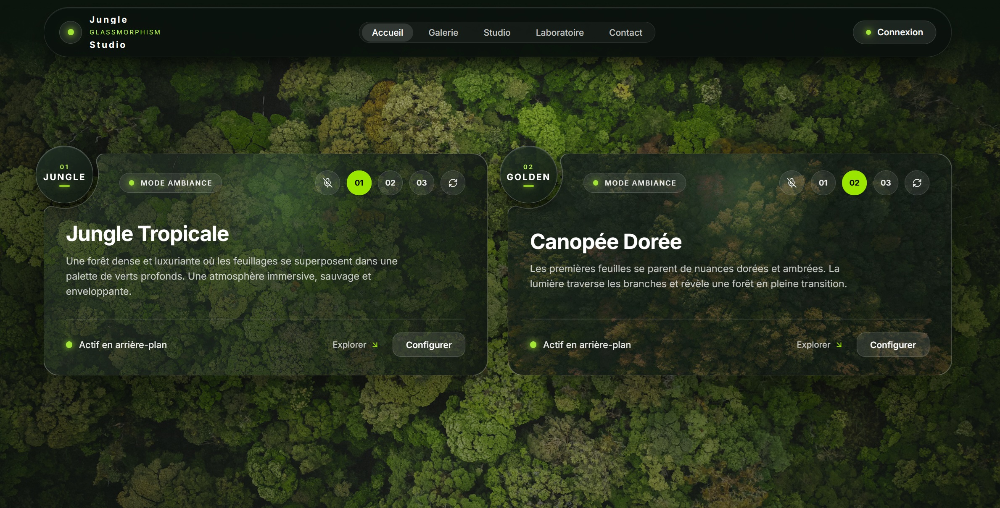

<div align="center">

# Jungle Glassmorphism Studio

**Le laboratoire des techniques de glassmorphism, appliquées à des interfaces de jungle immersives.**

[](https://nextjs.org/)
[](https://react.dev/)
[](https://www.typescriptlang.org/)
[](https://tailwindcss.com/)

[Voir le projet sur Vercel](https://vercel.com/dravix89s-projects/jungle-glassmorphism-studio)



</div>

---

## Sommaire

- [À propos](#à-propos)
- [Fonctionnalités](#fonctionnalités)
- [Pages](#pages)
- [Techniques de glassmorphism](#techniques-de-glassmorphism)
- [Technologies](#technologies)
- [Structure du projet](#structure-du-projet)
- [Installation](#installation)
- [Scripts](#scripts)
- [Déploiement](#déploiement)
- [Personnalisation](#personnalisation)
- [Authentification (démo)](#authentification-démo)
- [Compatibilité navigateurs](#compatibilité-navigateurs)
- [Crédits](#crédits)
- [Auteur](#auteur)

---

## À propos

**Jungle Glassmorphism Studio** est un site vitrine et interactif dédié au glassmorphism. Il montre comment créer des panneaux, des cartes et des conteneurs en verre dépoli, posés sur des photographies de jungle qui donnent du relief et de la profondeur à l'interface.

Chaque technique est présentée en démonstration vivante, avec le code CSS prêt à copier. Un laboratoire permet de régler le verre en temps réel sur l'ensemble du site.

---

## Fonctionnalités

- Hero avec cartes à encoche géométrique (découpe SVG) et badge flottant
- Changement d'ambiance botanique avec fondu entre les arrière-plans
- 10 techniques de glassmorphism en démonstration, avec CSS copiable
- Laboratoire temps réel : flou, densité, bordure, saturation, teinte et arrondi
- Code CSS généré automatiquement à partir des réglages
- Galerie avec filtres par catégorie et lightbox (clavier : Échap, flèches)
- Authentification de démonstration : connexion, inscription, mot de passe oublié
- Bouton de retour en haut en glassmorphism, avec anneau de progression du scroll
- Navbar opaque et élégante, menu mobile, lien actif selon la page
- Entièrement responsive, des mobiles aux grands écrans
- Notifications (toasts) et fallback automatique si une image ne charge pas

---

## Pages

| Route                  | Description                                                         |
| ---------------------- | ------------------------------------------------------------------- |
| `/`                    | Accueil : hero, aperçu des sections, fondamentaux, appel à l'action |
| `/galerie`             | Galerie botanique avec filtres et lightbox                          |
| `/studio`              | Les 10 techniques de glassmorphism en démonstration                 |
| `/laboratoire`         | Calibration optique en temps réel et CSS généré                     |
| `/contact`             | Formulaire de contact                                               |
| `/connexion`           | Connexion                                                           |
| `/inscription`         | Création de compte                                                  |
| `/mot-de-passe-oublie` | Réinitialisation du mot de passe                                    |

---

## Techniques de glassmorphism

| #   | Technique               | Principe                                                 |
| --- | ----------------------- | -------------------------------------------------------- |
| 01  | Verre classique         | Fond translucide, flou et bordure fine                   |
| 02  | Verre dépoli (Frosted)  | Flou fort combiné à une saturation boostée               |
| 03  | Verre sombre jungle     | Dégradé vert profond, signature du site                  |
| 04  | Verre teinté lime       | Dégradé coloré et lueur portée                           |
| 05  | Bordure spéculaire      | Bordure en dégradé réalisée avec un masque CSS           |
| 06  | Grain (Noise)           | Bruit fractal SVG en mode overlay                        |
| 07  | Lueur interne (Inset)   | Ombres internes multiples pour le volume                 |
| 08  | Découpe géométrique     | Encoche réalisée avec un masque radial                   |
| 09  | Verres empilés (Layers) | Deux vitres qui se chevauchent avec des flous différents |
| 10  | Liquid glass (SVG)      | Filtre de déplacement SVG (Chromium uniquement)          |

---

## Technologies

| Catégorie       | Outil                                                                                                           |
| --------------- | --------------------------------------------------------------------------------------------------------------- |
| Framework       | [Next.js 16](https://nextjs.org/) (App Router, Turbopack)                                                       |
| Bibliothèque UI | [React 19](https://react.dev/)                                                                                  |
| Langage         | [TypeScript](https://www.typescriptlang.org/)                                                                   |
| Styles          | [Tailwind CSS v4](https://tailwindcss.com/) et CSS natif                                                        |
| Images          | [`next/image`](https://nextjs.org/docs/app/api-reference/components/image) et [Unsplash](https://unsplash.com/) |
| Polices         | [Inter](https://fonts.google.com/specimen/Inter) et [JetBrains Mono](https://www.jetbrains.com/lp/mono/)        |

---

## Structure du projet

```text
jungle-glassmorphism-studio/
├── app/
│   ├── connexion/
│   │   └── page.tsx
│   ├── contact/
│   │   └── page.tsx
│   ├── galerie/
│   │   └── page.tsx
│   ├── inscription/
│   │   └── page.tsx
│   ├── laboratoire/
│   │   └── page.tsx
│   ├── mot-de-passe-oublie/
│   │   └── page.tsx
│   ├── studio/
│   │   └── page.tsx
│   ├── globals.css          # Styles globaux et classes .tech-*
│   ├── icon.svg             # Favicon
│   ├── layout.tsx           # Layout racine (navbar, footer, providers)
│   ├── not-found.tsx        # Page 404
│   └── page.tsx             # Accueil
│
├── components/
│   ├── AuthShell.tsx        # Cadre commun des pages d'authentification
│   ├── Background.tsx       # Arrière-plan botanique avec fondu
│   ├── CodeBlock.tsx        # Bloc de code avec bouton Copier
│   ├── ContactForm.tsx
│   ├── Footer.tsx
│   ├── ForgotForm.tsx
│   ├── GalleryGrid.tsx      # Galerie, filtres et lightbox
│   ├── HeroCard.tsx         # Carte à encoche du hero
│   ├── HeroCards.tsx
│   ├── JungleImg.tsx        # Image Unsplash avec fallback
│   ├── Lab.tsx              # Laboratoire de calibration
│   ├── LoginForm.tsx
│   ├── Navbar.tsx
│   ├── PageHeader.tsx
│   ├── PasswordField.tsx
│   ├── Providers.tsx        # Contexte global (verre, scène, auth, toast)
│   ├── RegisterForm.tsx
│   ├── ScrollToTop.tsx      # Bouton de retour en haut
│   └── TechniqueCard.tsx    # Démonstration d'une technique
│
├── lib/
│   ├── glass.ts             # Réglages du verre et génération du CSS
│   ├── images.ts            # Images Unsplash, scènes et galerie
│   └── techniques.ts        # Données et code des 10 techniques
│
├── public/
│   └── apercu.jpg           # Capture d'écran du README
│
├── next.config.ts
├── postcss.config.mjs
├── tsconfig.json
└── package.json
```

---

## Installation

### Prérequis

- [Node.js](https://nodejs.org/) 20 ou supérieur
- npm

### Étapes

```bash
# 1. Cloner le dépôt
git clone https://github.com/Dravix89/jungle-glassmorphism-studio.git

# 2. Aller dans le dossier
cd jungle-glassmorphism-studio

# 3. Installer les dépendances
npm install

# 4. Lancer le serveur de développement
npm run dev
```

Ouvrez ensuite [http://localhost:3000](http://localhost:3000).

---

## Scripts

| Commande        | Description                       |
| --------------- | --------------------------------- |
| `npm run dev`   | Lance le serveur de développement |
| `npm run build` | Génère le build de production     |
| `npm run start` | Lance le build de production      |

---

## Personnalisation

### Changer la largeur du site

Dans `app/globals.css`, ajoutez après `@import "tailwindcss";` :

```css
@theme {
  --container-7xl: 90rem; /* 1440px. Valeur par défaut : 80rem (1280px) */
}
```

### Changer les images

Toutes les images sont centralisées dans `lib/images.ts`. Remplacez les identifiants Unsplash pour changer les photos du site. Une image indisponible est remplacée automatiquement par un dégradé vert.

### Ajouter une technique de verre

1. Ajoutez la classe CSS `.tech-monnom` dans `app/globals.css`.
2. Ajoutez une entrée dans `lib/techniques.ts` avec son nom, sa description et son code.

### Modifier le verre global

Les valeurs par défaut (flou, densité, bordure, saturation, teinte) sont dans `lib/glass.ts`.

---

## Authentification (démo)

L'authentification est une démonstration côté navigateur :

- Les comptes sont stockés dans `localStorage`.
- Les mots de passe sont hachés en SHA-256 (Web Crypto).
- Le flux de mot de passe oublié est simulé.

Pour une utilisation réelle, remplacez les fonctions `login`, `register` et `forgot` dans `components/Providers.tsx` par votre backend (Auth.js, Supabase, Firebase, etc.).

---

## Compatibilité navigateurs

| Fonctionnalité              | Chrome / Edge |   Safari    |   Firefox   |
| --------------------------- | :-----------: | :---------: | :---------: |
| `backdrop-filter`           |      Oui      |     Oui     |     Oui     |
| Bordure spéculaire (masque) |      Oui      |     Oui     |     Oui     |
| Liquid glass (filtre SVG)   |      Oui      | Flou simple | Flou simple |

---

## Crédits

- Photographies : [Unsplash](https://unsplash.com/) et leurs photographes
- Polices : [Google Fonts](https://fonts.google.com/)

---

## Auteur

**David Roussety**

[](https://github.com/Dravix89)

---

<div align="center">

Fait avec soin par **David Roussety** · 2026

</div>
